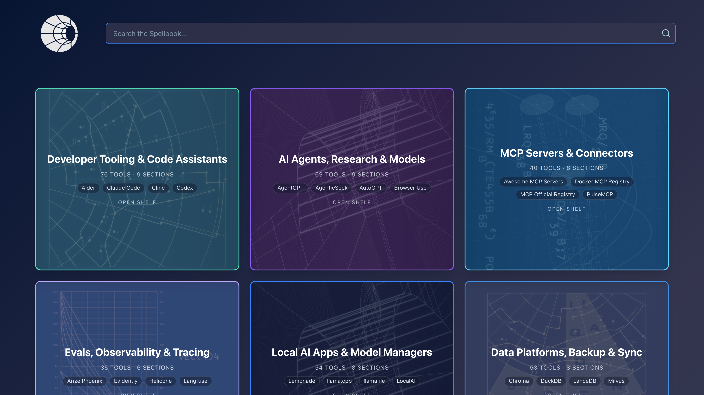
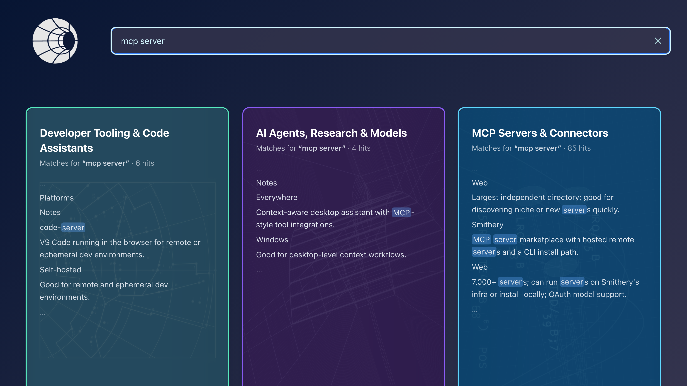
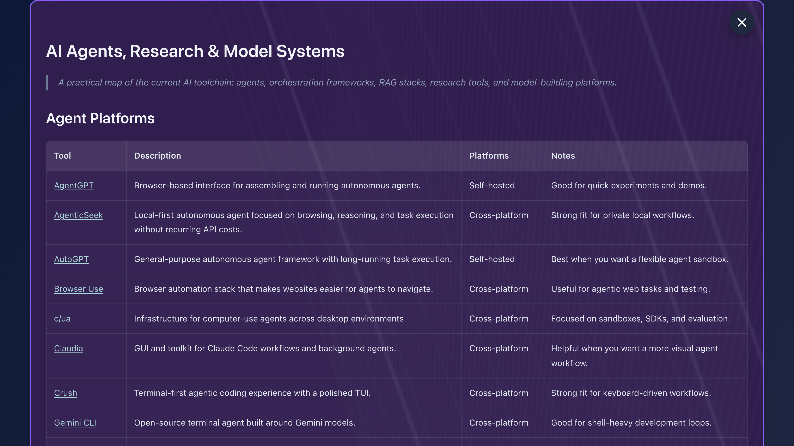
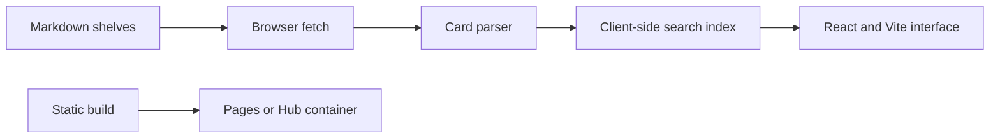
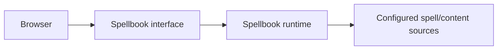

<h1 align="center">CI-Spellbook</h1>

<p align="center"><strong>A curated catalog of local-AI agents, apps, and tools.</strong></p>

[](https://github.com/companionintelligence/CI-Spellbook/releases)
[](https://github.com/companionintelligence/CI-Spellbook)
[](LICENSE.md)
[](https://discord.com/invite/yQp9hwpzAa)

<p align="center"><a href="https://magic.ci.computer">Website</a> · <a href="#quick-start">Get started</a> · <a href="https://docs.ci.computer/docs/reference/open-source-systems">Systems map</a> · <a href="docs/CI.md">Documentation</a></p>

<p align="center">
  <a href="https://magic.ci.computer"></a>
</p>

## License
Free for noncommercial use under the [PolyForm Noncommercial License 1.0.0](LICENSE.md). This repository is public. Copyright LifeScope INC, DBA Companion Intelligence. See the [License FAQ](docs/License-FAQ.md).

## Summary
Spellbook is a searchable catalog of local-AI and self-hosting tools, from model managers and MCP connectors to home servers, networking and edge hardware. It is sixteen shelves, each a markdown table, organized by the job you are doing rather than by vendor. Search runs in the browser across every shelf.

It is published at <https://magic.ci.computer> and ships as a container image for the Companion Hub App Store. Every page links back to Companion Intelligence (<https://ci.computer>), to the app's page in the docs, and to the two calls to action every Companion site carries (**Buy Companion Core** at <https://ci.computer/core>, **Download Companion** at <https://ci.computer/download>). Those URLs and the page's public copy are written once, in [`src/lib/site.js`](src/lib/site.js); see [Checks](#checks).


## Features

| Feature | What it provides |
|---|---|
| **Curated shelves** | Browse agent, MCP and self-hosting collections assembled from Markdown. |
| **Client-side search** | Load and parse shelf data in the browser, then search locally. |
| **Static deployment** | Serve the built site on Cloudflare Pages or as a Hub app container. |

## Screenshots

<table>
  <tr>
    <td valign="top"><p align="center">Spellbook library at first run</p></td>
    <td valign="top"><p align="center">Search for an MCP server</p></td>
    <td valign="top"><p align="center">Open an AI agent card</p></td>
  </tr>
</table>


## How it fits together

The public site is static: the browser loads curated Markdown shelves, parses the cards and builds search locally; the container and Pages deployment serve the same assets.



## Quick Start
```bash
npm install
npm run dev   # Vite dev server on http://localhost:5500
```

### Deno

The same app also runs under [Deno](https://deno.com) via its npm compat layer
— no source rewrite, `deno.json` mirrors the npm scripts as `deno task`s:

```bash
deno install   # populates node_modules from package.json, same deps npm would
deno task dev  # Vite dev server on http://localhost:5500
deno task build
deno task test:unit   # vitest
deno task test        # playwright (see note below)
deno task check       # deno's built-in TypeScript checker over the JSX/JS source
```

`deno task check` is new — this repo had no type checking of any kind before.
It runs against the plain `.js`/`.jsx` sources directly via `checkJs` +
`allowJs` (see `deno.json`'s `compilerOptions` and the sibling
`tsconfig.json`, kept for editors/other TS tooling that reads `tsconfig.json`
specifically rather than `deno.json`).

Known gap: `deno task test` (Playwright) currently fails to load
`playwright.config.js` under Deno — Playwright's ESM config loader depends on
Node's `node:module.register()` custom-loader hook, which Deno 2.9's Node
compat does not implement yet. `npm test` / `npx playwright test` still work
normally under real Node. See the deno-migration PR for details.

## Where it runs

| Channel | What | How it is built |
|---|---|---|
| <https://magic.ci.computer> | The public site: a Cloudflare Pages project connected to this repository. Cloudflare builds and deploys it itself; no workflow in this repo does. | `npm run build` to `dist/`, with `NODE_AUTH_TOKEN` set in the Pages project (the canon packages are private). See [`docs/operations/cloudflare-pages.md`](docs/operations/cloudflare-pages.md). |
| `ghcr.io/companionintelligence/ci-spellbook` | The container the Hub App Store installs (nginx on port 5500). | The `Dockerfile` (Deno), published by `docker-publish.yml`, which is started by hand. |
| Android APK, iOS Simulator app | Unsigned debug builds of the Capacitor shells in `apps/`. Not published anywhere and not store builds; see [Mobile apps](#mobile-apps-ios-and-android). | `mobile-build.yml`, started by hand. |

`.github/workflows/ci.yml` tests and smoke-builds; it does not deploy. All three workflows are `workflow_dispatch`-only (see [`docs/CI.md`](docs/CI.md), which is generated and does not list `mobile-build.yml` yet).

## Run with Docker

A public multi-arch (amd64/arm64) image is published to GHCR. nginx serves the
built site on port **5500** inside the container:

```bash
docker run -d --name ci-spellbook -p 5500:5500 \
  ghcr.io/companionintelligence/ci-spellbook:latest
# open http://localhost:5500
```

To build the image locally:

```bash
docker build -t ci-spellbook .
docker run -d -p 5500:5500 ci-spellbook
```

## Install as an app (PWA)

The site installs from the browser with no store involved: the install icon in Chrome's or Edge's address bar (or "Install app" in the menu), and Share, then Add to Home Screen, on iOS. [`public/site.webmanifest`](public/site.webmanifest) makes it open in its own window (`display: standalone`), and [`public/sw.js`](public/sw.js) is its service worker, registered from the bundle by [`src/lib/serviceWorker.js`](src/lib/serviceWorker.js) (the CSP allows no inline script).

The worker is deliberately small. It caches three files once, at install, all under `/offline/`: the offline page [`public/offline/`](public/offline/index.html), its stylesheet and its own copy of the mark. A page load that cannot reach the network gets that page instead of the browser's error screen. It never caches the app, the catalog markdown or any other response, and it answers no request but a page load and those three files. Nothing the app itself requests is served by it, so a deploy is live on the next load and the app cannot be served stale. (The header brand mark is `/logo/mark.svg`; the offline page has its own copy, `public/offline/mark.svg`, because an answer from a worker's cache is never revalidated.) It is not registered in `npm run dev`, on plain-http addresses (browsers only offer service workers on https and localhost) or inside the Capacitor shells below, which already carry the bundle.

- Change a precached file (`public/offline/*`) and the `CACHE` name in `public/sw.js` has to change with it. The name carries a fingerprint of the files (line endings are ignored), and a browser fetches them again only when `sw.js` changes. `npm run build`, so the Pages build and the image build too, and `npm run test:unit` fail, and print the name to use, when it does not. `npm run brand:sync` refreshes `public/offline/mark.svg` with the other brand files, and the build then asks for the new name. Without Node (the three `PRECACHE` entries, in order, carriage returns removed), from `public/`:

  ```bash
  { printf '/offline/\0'; tr -d '\r' < offline/index.html; printf '\0'
    printf '/offline/offline.css\0'; tr -d '\r' < offline/offline.css; printf '\0'
    printf '/offline/mark.svg\0'; tr -d '\r' < offline/mark.svg; printf '\0'; } | shasum -a 256 | cut -c1-12
  ```
- The offline page is `/offline/`, not `/offline.html`: Cloudflare Pages redirects `*.html` to its clean URL, and a service worker that answers a page load with a redirected response fails it. Nothing outside `/offline/` may be added to the worker's list; the build fails if it is.
- **Rolling back:** reverting the commit that added the worker does not remove it from the browsers that installed it: with `/sw.js` gone, a browser's update check gets a 404, fails, and the old worker stays. To retire it: (1) copy [`docs/operations/service-worker-kill-switch.js`](docs/operations/service-worker-kill-switch.js) over `public/sw.js` (it deletes the offline cache and unregisters itself); (2) delete the `registerServiceWorker()` call, and its import, from `src/main.jsx`; (3) deploy, and keep it deployed for a few weeks, because browsers pick it up on their next visit. Step 2 matters: with the registration left in, every visit registers the kill switch again, which installs, deletes the offline caches and unregisters itself, so it is harmless but pointless, and the build does not stop you. Nothing else has to change. The file's first line is how `npm run build`, the unit tests and the `pwa` Playwright project recognise it and stop requiring the offline page, the precache list, the cache fingerprint and the registration in the bundle; the manifest, the head tags and the `no-cache` rule for `/sw.js` are still checked. [`tests/pwa.spec.js`](tests/pwa.spec.js) runs that file in a real browser. Until it is retired, an old copy of the worker is harmless: it serves a static page and nothing else.
- **Known limits:** the maskable icon, `public/logo/icon-maskable-512.png`, is the canon asset and is byte for byte the same transparent image as `icon-512.png`, not a full-bleed plate, so Android supplies its own background behind it and how that looks was not checked on a device. An opaque `#071533` maskable icon belongs in CI-Common's assets, then `npm run brand:sync`. Install and offline behaviour were checked in desktop Chrome only (`tests/pwa.spec.js`); iOS Add to Home Screen, Quest Browser, Android devices and other browsers were not.
- **Checking it:** `npx playwright test --project=pwa` builds the site, serves `dist/` with the production headers, and checks in Chrome that the worker installs under the CSP, that Chrome reports no installability error, that the cache holds only the three offline files, that the worker answers nothing the app loads, and that a page load with no network shows the offline page. After a deploy, `PWA_URL=https://magic.ci.computer npx playwright test --project=pwa` runs the same checks against the live site, with no local server or build ([the Pages runbook](docs/operations/cloudflare-pages.md#checking-a-deploy)).

## Mobile apps (iOS and Android)

`apps/ios` and `apps/android` are [Capacitor](https://capacitorjs.com) shells (app id `com.companionintelligence.spellbook`, name "Companion Spellbook") that put the Vite build, `dist/`, in a native WebView. The shelves are static markdown inside the bundle and are fetched from the app's own origin, so the apps work offline and need no server. Outbound links leave the app for the system browser.

Each shell is its own npm project and is **not** part of the root install, so Capacitor stays out of the web bundle, the Docker image's `deno install --frozen` and the lockfile check. The layout follows [Companion Planning](https://github.com/companionintelligence/CI-Planning)'s `mobile/ios` and `mobile/android` (Capacitor 8.6, Swift Package Manager on iOS). Companion-Memory's shells are still on Capacitor 7.

```bash
npm run build                                        # web bundle -> dist/ (repo root)

cd apps/android && npm ci && npx cap sync android    # then `npx cap open android`
cd android && ./gradlew assembleDebug                #   or build the debug APK directly

cd apps/ios && npm ci && npx cap sync ios            # then `npx cap open ios`
```

`npm run build` inside a shell runs the web build and then the sync. Needs Node 22 or later (Capacitor 8's CLI), JDK 21 and Android SDK platform 36 for Android (Android Studio Otter 2025.2.1 or later if you open it there), and Xcode 26 or later for iOS (built here with Xcode 27.0). The iOS project uses Swift Package Manager, not CocoaPods: `cap sync` rewrites `apps/ios/ios/App/CapApp-SPM/Package.swift`, and Xcode fetches `capacitor-swift-pm` from GitHub on the first build. Set `CAP_SERVER_URL` before a sync to load a live dev server instead of the bundle; never for a build you ship.

What differs from Capacitor's defaults, and why:

- **Pinch-zoom** is on in both shells (`ios.zoomEnabled` and `android.zoomEnabled`). Capacitor's default is off, which would take away the zoom the site allows (WCAG 1.4.4).
- **iOS** deployment target 16.4, iPhone only (`TARGETED_DEVICE_FAMILY` 1) until an iPad layout has been checked, a dark interface style, and `ITSAppUsesNonExemptEncryption` false. Capacitor 8's own default target is 15.0; 16.4 is the Safari that Tailwind CSS 4 documents as its floor, and it is above the 16.0 that App Intents need. The `SceneDelegate` and the `UIApplicationSceneManifest` are Capacitor 8.5's: the UIScene life cycle is required by the iOS 26 and later SDKs.
- **Android** compileSdk and targetSdk 36, AGP 8.13.0 on Gradle 8.14.3, minSdk 24, `minWebViewVersion` 111 (Tailwind CSS 4's Chrome floor; Capacitor's default is 60; below it Capacitor logs an error but still loads the page, since no `server.errorPath` is set) and `allowBackup` false. A dark window background so the strips behind the system bars are not white.
- Plugins: `@capacitor/app`, `@capacitor/splash-screen` and `@capacitor/status-bar`, configured in `capacitor.config.ts`. The web app does not call them.
- Icons and splash are generated from `apps/assets/`, which is built from `@companionintelligence/assets`' `logo.app-icon` (the company mark) on the app's navy. They are placeholders, not Spellbook-specific artwork. To regenerate: `npx @capacitor/assets@3 generate --ios --assetPath ../assets --iconBackgroundColor '#071533' --iconBackgroundColorDark '#071533' --splashBackgroundColor '#071533' --splashBackgroundColorDark '#071533'` from `apps/ios` (use `--android` in `apps/android`).

`mobile-build.yml` builds an **unsigned** debug APK and an **unsigned** iOS Simulator `.app` and uploads them as artifacts. It is not a store build: there is no signing, no store listing and no privacy declaration yet.

## Tests

```bash
npm run test:unit                    # vitest: the app rendered in jsdom, markdown safety, shelf loading,
                                     #   the debug-panel regression, the site and lockfile checks, telemetry
npx playwright test                  # smoke tests in a real browser (starts the dev server itself), and the
                                     #   installable-build checks, which build dist/ and serve it with the production headers
npx playwright test --project=pwa    # just those (tests/pwa.spec.js)
APP_URL=http://localhost:5500 \
  npx playwright test --config=tests/container/playwright.config.ts   # against a running container
```

## Checks

| Command | What it fails on |
|---|---|
| `npm run build` | A page whose static copy of the links or copy has drifted from [`src/lib/site.js`](src/lib/site.js): the metadata, the `<noscript>` fallback, `404.html`, `robots.txt`, `sitemap.xml`, the web manifest, the CSP in `public/_headers` (it must not allow inline script or style), and the four cross-links. It also fails when the app stops being installable: a manifest that is not `display: standalone` or lacks a 192, 512 or maskable icon, a missing head tag, a service worker that precaches a file that is not there or one outside `/offline/`, a `CACHE` name that no longer matches the fingerprint of the precached files, or a bundle that no longer registers `/sw.js` (none of the worker checks applies to the kill switch, which is how the worker is retired: see Rolling back above). It runs inside the Vite build ([`scripts/assert-site.mjs`](scripts/assert-site.mjs)), so the Pages build and the Docker build run it too. |
| `npm run check:lockfiles` | `package.json`, `package-lock.json` and `deno.lock` listing different dependencies, or resolving a direct dependency or any `@companionintelligence/*` package to different versions (the Pages bundle is built from the first, the container image from the second, so a mismatch ships different design tokens from one commit). The Docker build runs `deno install --frozen`, which refuses a stale `deno.lock` but not one that disagrees with `package-lock.json`. After changing dependencies: `npm install`, then `NODE_AUTH_TOKEN=... deno install --frozen=false`, and commit both lockfiles together. |
| `npm run check:ga-build` | Analytics leaking into a build that did not ask for it, or half-present in one that did. Runs real builds with `GA_MEASUREMENT_ID` unset, malformed and valid, and a repeat of the valid one. |
| `npm run lint:content` | A shelf with the wrong table shape, raw HTML, or a link that is not `https`. |
| `npm run check:links` | A catalog link that is gone. Networked, so run on purpose rather than on every push; with `GITHUB_TOKEN` set it also reports archived and renamed GitHub repos. |
| `npm run lint:canon` | A brand colour off the canon, or a brand file under `public/` that differs from `@companionintelligence/assets`. |

## Error reporting

Crash reporting is **opt-out**: on a build configured with a DSN it is **on by
default**, and `CI_TELEMETRY=off` or `CI_LOCAL_ONLY=true` on the container turn
it off without a rebuild (the app-store **Share crash reports** toggle sets the
former). With no `VITE_SENTRY_DSN` set at build time — a source checkout, `npm
run dev`, or any unconfigured build — the Sentry SDK is tree-shaken out of the
bundle entirely, so there is nothing to switch off and the app cannot phone
home.

Spellbook serves no API of its own, so on a bare static host (Cloudflare Pages,
`npm run serve`) the consent check 404s and reporting stays off regardless.

See [`docs/operations/error-reporting.md`](docs/operations/error-reporting.md).

## Content

Each shelf is one markdown file in `public/markdown/`, named after its title (`ai-agents.md`, `mcp-servers.md`, ...), and one entry in `CARD_CONFIGS` in `src/App.jsx`. A shelf is a title, a one-line `>` blurb, and tables of `Tool | Description | Platforms | Notes`; `npm run lint:content` holds it to that. To add a shelf, add the file and the entry.

The `id` and `containerId` in `CARD_CONFIGS` are stable keys, not descriptions: the video storyboard and the `#shelf-...` anchors address cards by them, so they keep their historical names where a shelf has since been retitled (`xr-spatial` is the Desktop Systems shelf).

The markdown directory is copied into the build by Vite (`publicDir`), so edits ship with the next deploy or image build. The shelf art lives in `src/assets/background/` (WebP, imported so Vite fingerprints it). `archive/` holds retired content that is intentionally **not** shipped; `dev-tools/` holds the catalog checks and some manual browser debug helpers.

A tool listed on two shelves is two rows and one tool; the "N tools" the page prints counts distinct links.

## Design

Colour and type come from the canon token package, [`@companionintelligence/tokens`](https://github.com/companionintelligence/CI-Common) (CI-Common): `src/styles.css` imports its `tokens.css`, and this is a dark-only surface (`<html class="dark">`). The page font is the canon stack (Manrope, then the system UI font); no webfont files are shipped, so it renders in the system font unless Manrope is installed. The one palette that is not canon is each shelf's accent, in `CARD_CONFIGS`.

The logo, icons and favicons under `public/` are verified copies of `@companionintelligence/assets`, not originals: change them in CI-Common, then `npm run brand:sync`. `npm run lint:canon` fails if one has drifted. The 1200x630 share image, `public/og-image.png`, is Spellbook's own (CI-Common's `assets/og/` has no Spellbook image yet).

Analytics is **opt-in at build time** and off by default. Set `GA_MEASUREMENT_ID` (a GA4 ID, `G-XXXXXXXX`) in the environment of a build and [`scripts/ga4.mjs`](scripts/ga4.mjs) adds the gtag loader and an emitted `/ga-init.js` to `index.html` and `404.html`, and extends the CSP in the built `dist/_headers` with the hosts Google Analytics needs (nothing else changes). With it unset or malformed, the pages and `_headers` come out exactly as committed: no tags, no init file, no Google host in the CSP. Only the Cloudflare Pages build sets it ([`docs/operations/cloudflare-pages.md`](docs/operations/cloudflare-pages.md)); the Dockerfile forwards nothing but the `VITE_*` crash-reporting arguments, so the container image, which runs on a person's own machine, stays analytics-free. The ID is never committed, and `npm run build` fails if a tag or ID turns up in the source HTML.

<!-- companion-hub-readme-deep-review -->

## Runtime options

| Mode | Start point | Address / behavior |
|---|---|---|
| Deno | Commands in the Deno section | Runs directly with the Deno runtime |
| Docker | Compose/run instructions below | Dashboard is exposed on port `5500` |
| Tests and checks | Existing test/check commands | Run before publishing changes |



This repository is public and licensed under PolyForm Noncommercial 1.0.0 (see [License](#license)). Do not publish private prompts or personal content through a public deployment.

