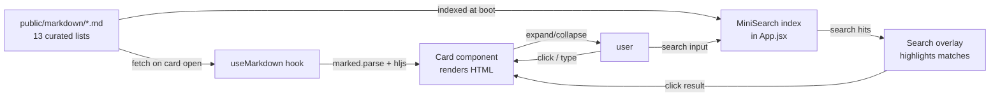
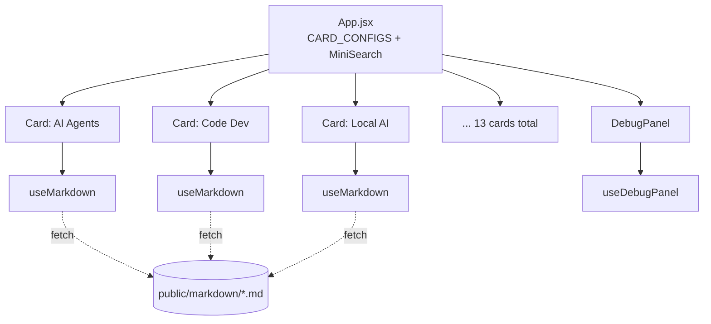
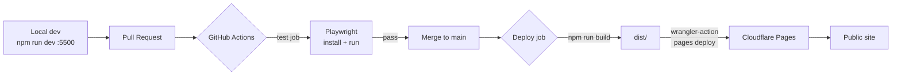
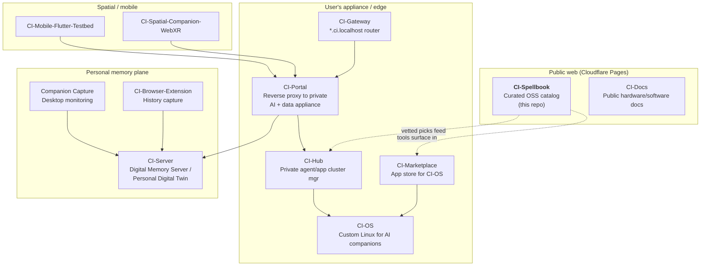
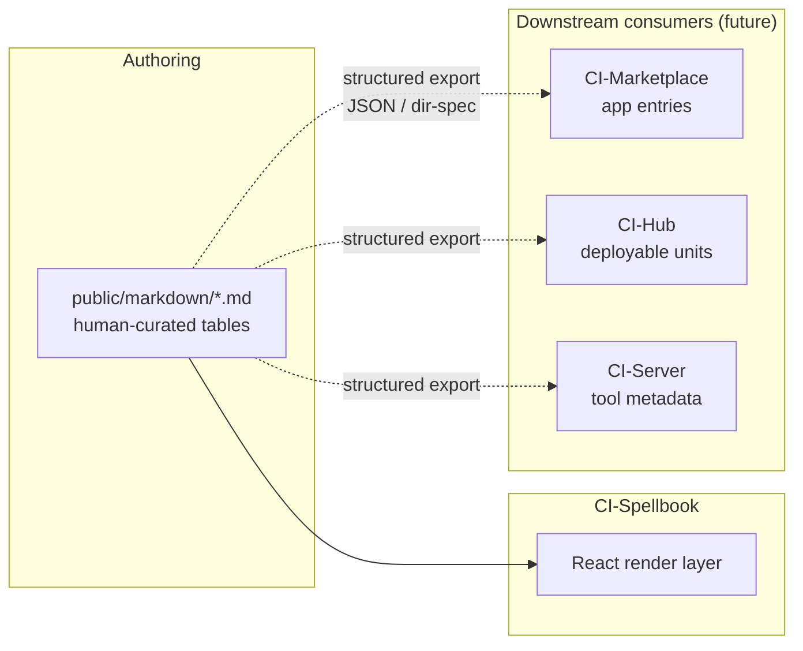

# CI-Spellbook — Architecture

> Public-facing, card-driven catalog of recommended private AI agents, apps, and tools (mostly OSS). Built as a static React + Vite SPA that hydrates from curated Markdown files and deploys to Cloudflare Pages.

## TL;DR

| Aspect | Value |
| --- | --- |
| Role in product line | Public "what we recommend" surface — the discovery & vetting layer in front of CI products |
| Stack | Vite 5 + React 18 + Tailwind 4 + `marked` + `minisearch` + `highlight.js` |
| Content | 13 curated `.md` files in [public/markdown/](../public/markdown/) (tools grouped by category) |
| Deploy | GitHub Actions → Cloudflare Pages (`main` branch, post-Playwright) |
| Tests | Playwright e2e against the dev server (`npm test`) |
| Repo | [companionintelligence/CI-Spellbook](https://github.com/companionintelligence/CI-Spellbook) |

## Repository layout

| Path | Purpose |
| --- | --- |
| [src/App.jsx](../src/App.jsx) | Card configuration registry + top-level layout + search wiring |
| [src/components/Card.jsx](../src/components/Card.jsx) | Expandable card UI; loads & renders one markdown file |
| [src/components/DebugPanel.jsx](../src/components/DebugPanel.jsx) | Dev-only diagnostic overlay |
| [src/hooks/useMarkdown.js](../src/hooks/useMarkdown.js) | Fetch + `marked` parse + `highlight.js` syntax highlight |
| [src/hooks/useDebugPanel.js](../src/hooks/useDebugPanel.js) | Debug panel state |
| [public/markdown/](../public/markdown/) | 13 curated topical tool lists (the actual product content) |
| [public/markdown-legacy-20260315/](../public/markdown-legacy-20260315/) | Snapshot of prior content; kept for diffing/rollback |
| [public/background/](../public/background/), [public/logo/](../public/logo/) | Static visual assets |
| [tests/](../tests/) (Playwright) | E2E smoke tests; runs in CI |
| [.github/workflows/ci.yml](../.github/workflows/ci.yml) | Test + Cloudflare Pages deploy pipeline |
| [vite.config.js](../vite.config.js) | Dev server on `:5500`, `publicDir: 'public'` |

## Runtime data flow



## Component model



Card configs live in [src/App.jsx](../src/App.jsx) as a static array — adding a topic = adding a `.md` + a registry entry.

## Build & deploy pipeline



| Stage | Trigger | Action | Secret(s) |
| --- | --- | --- | --- |
| `test` | PR + push | `npm ci` → install Playwright → `npm test` | — |
| `deploy` | push to `main` (after tests) | `npm run build` → `wrangler pages deploy dist` | `CLOUDFLARE_API_TOKEN`, `CLOUDFLARE_ACCOUNT_ID`, `CLOUDFLARE_PAGES_PROJECT` |

## Where CI-Spellbook sits in the Companion Intelligence product line

CI-Spellbook is the **public discovery surface** — the curated, opinionated catalog. The private appliance, memory store, and marketplace live in sibling repos.



### How each sibling relates

| Repo | Role | Relationship to CI-Spellbook |
| --- | --- | --- |
| [CI-Portal](https://github.com/companionintelligence/CI-Portal) | Proxy to the user's private AI + data appliance | Spellbook recommends categories; Portal is the gateway people *use* the recommendations through |
| [CI-Server](https://github.com/companionintelligence/CI-Server) | Digital Memory Server / personal digital twin backend | Tools listed under "RAG / Knowledge" and "Databases" inform what Server integrates |
| [CI-Marketplace](https://github.com/companionintelligence/CI-Marketplace) | App store for CI-OS | Should ingest a structured form of Spellbook entries as installable app candidates |
| [CI-Hub](https://github.com/companionintelligence/CI-Hub) | Private agent/app cluster manager | Consumes Spellbook's "agents" + "local-first" categories as deployable units |
| [CI-OS](https://github.com/companionintelligence/CI-OS) | Custom Linux distro | Target runtime for Marketplace/Hub installs of Spellbook-listed tools |
| [CI-Gateway](https://github.com/companionintelligence/CI-Gateway) | `*.ci.localhost` reverse proxy for local dev | Dev-time front door for Portal + sibling services |
| [CI-Docs](https://github.com/companionintelligence/CI-Docs) | Public docs | Sister public surface to Spellbook; Spellbook is "what to use", Docs is "how to use it" |
| [CI-Browser-Extension](https://github.com/companionintelligence/CI-Browser-Extension) | Browsing history capture | Feeds Server; surfaces in Spellbook's "Browser Automation" category |
| [CI-Capture](https://github.com/companionintelligence/CI-Capture) | Companion Capture — desktop monitor | Feeds Server |
| [CI-Marketing](https://github.com/companionintelligence/CI-Marketing) | Social automation via Metricool/Reddit | Could auto-syndicate Spellbook updates to social channels |
| [JustInCase](https://github.com/companionintelligence/JustInCase) | Offline emergency knowledge | Sibling content product (offline-first counterpart to Spellbook) |

### Logical contract between Spellbook and the rest



Today the `.md` tables are the source of truth for humans only. Promoting them to a **structured JSON / Agntcy-compatible directory feed** is the natural integration seam — see [roadmap.md](roadmap.md).

## Content shape

Each `public/markdown/*.md` file follows a stable convention:

```markdown
# <Topic title>

> One-line description of the category.

## <Subcategory>

| Tool | Description | Platforms | Notes |
| --- | --- | --- | --- |
| [Name](repo-url) | ... | Cross-platform / Self-hosted / ... | ... |
```

That regularity is what makes automated extraction (JSON feeds, marketplace ingestion, freshness checks against GitHub) practical without rewriting the content layer.

## Known constraints & rough edges

| Area | Note |
| --- | --- |
| Card registry | Hard-coded array in [src/App.jsx](../src/App.jsx); adding a topic touches code, not just content |
| Search | MiniSearch indexes at boot in the browser — fine for 13 files, will need rethinking past ~100 |
| Markdown rendering | `marked` v5 + manual `highlight.js` plumbing in [useMarkdown.js](../src/hooks/useMarkdown.js); newer `marked` extension API would be cleaner |
| Tests | Single Playwright suite; no link-rot or markdown-lint checks yet |
| Legacy snapshot | `public/markdown-legacy-20260315/` ships in the bundle; consider moving out of `public/` |
| Content drift | No automation re-checks whether linked tools are still maintained / repo still exists |
