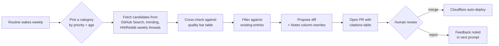

# Content Expansion Plan

> Companion to [architecture.md](architecture.md) and [roadmap.md](roadmap.md). Defines what categories exist, what should be added, source quality bar, and how the weekly auto-research routine should treat each.

> **File names changed (2026-10).** The snapshot below, and the sections after it, use the original file names. The shelves are now named after their titles in the UI; `CARD_CONFIGS` in `src/App.jsx` is the source of truth, and the card `id`s there are stable keys that kept their old names.
>
> | Original file | Now |
> | --- | --- |
> | AI Agents & Autonomous Systems.md | `ai-agents.md` |
> | AI-Assisted Code Development.md | `developer-tooling.md` |
> | Local-First AI Tools.md | `local-ai-apps.md` |
> | AI Art Generation Images 3D and Video.md | `creative-media.md` |
> | AI in Video Games & Virtual Beings.md | `entertainment-games.md` |
> | Cutting Edge Databases.md | `data-platforms.md` |
> | Home Automation & Security.md | `self-hosting.md` |
> | Maker & Hardware Prototyping.md | `hardware-edge.md` |
> | Networking VPN & Infrastructure Security.md | `security-network.md` |
> | Speech-to-Text & Text-to-Speech.md | `speech-collaboration.md` |
> | Top Public Data Sources.md | `knowledge-notes.md` |
> | Virtual Machine and Browser Automation and Scrapers.md | `browsers-automation.md` |
> | XR & Spatial Computing.md | `desktop-systems.md` |
> | MCP Servers & Connectors.md | `mcp-servers.md` |
> | Evaluation, Observability & Tracing.md | `evals-observability.md` |
> | Embeddings & Vector Pipelines.md | `embeddings-vector.md` |
>
> Two checks apply to every shelf before a PR: `npm run lint:content` (table shape; no raw HTML or non-https link) and, when links were touched, `npm run check:links`.

## Current categories (snapshot 2026-06-10)

| File | Coverage today | Saturation | Auto-research priority |
| --- | --- | --- | --- |
| AI Agents & Autonomous Systems.md | Agent platforms, workspaces, RAG/research, frameworks | Medium | **High** — moves weekly |
| AI-Assisted Code Development.md | Assistants, editors, API clients, git tools, package managers | Medium | **High** — moves weekly |
| Local-First AI Tools.md | Clients, model managers, assistants, doc workflows | Medium | **High** — moves weekly |
| AI Art Generation Images 3D and Video.md | Image / 3D / video gen | Medium | Medium |
| AI in Video Games & Virtual Beings.md | Game AI, NPC, virtual beings | Low | Medium |
| Cutting Edge Databases.md | Vector, graph, embedded, sync | Medium | Medium |
| Home Automation & Security.md | HA, NVR, sensors | Medium | Low |
| Maker & Hardware Prototyping.md | Boards, fabrication, firmware | Medium | Low |
| Networking VPN & Infrastructure Security.md | VPN, mesh, proxy, scanners | Medium | Low |
| Speech-to-Text & Text-to-Speech.md | STT/TTS engines | Medium | Medium |
| Top Public Data Sources.md | Datasets, indexes | Medium | Low |
| Virtual Machine and Browser Automation and Scrapers.md | VM, headless, scrapers | Medium | Medium |
| XR & Spatial Computing.md | XR runtimes, scanning, headsets | Medium | Medium |
| MCP Servers & Connectors.md | Registries, servers, gateways, SDKs | Medium | **High** — moves weekly |
| Evaluation, Observability & Tracing.md | Tracing, evals, guardrails | Medium | **High** — moves weekly |
| Embeddings & Vector Pipelines.md | Embedding serving, parsing, chunking, rerankers | Medium | Medium |

## Categories worth adding

| Proposed file | Why it fits | Seed picks (high confidence) |
| --- | --- | --- |
| `MCP Servers & Connectors.md` | MCP is now the lingua franca for agent tool use; user's stack is heavy on it | `modelcontextprotocol/servers`, community MCP catalogs |
| `Evaluation, Observability & Tracing.md` | Critical for agent ops; not covered today | `langfuse`, `helicone`, `arize-phoenix`, `openllmetry`, `inspect-ai` |
| `Embeddings & Vector Pipelines.md` | Adjacent to Databases but distinct concern | `txtai`, `instructor`, `voyage`, `chunkr` |
| `Personal Knowledge & Notes.md` | Aligns with CI-Server (Digital Memory) audience | Obsidian/Logseq/Anytype/Reor are scattered — consolidate |
| `Self-Hosting & Homelab.md` | Bridges Home Automation + Networking + Local AI | `Yunohost`, `CasaOS`, `another self-hosted platform`, `Coolify` |
| `Privacy & Identity.md` | Aligns with CI ethos (private appliance) | `Authelia`, `Pocket ID`, `Vaultwarden`, `Bitwarden` |
| `Calendars, Email & Contacts (Self-Hosted).md` | Common ask for personal-data appliances | `SOGo`, `Radicale`, `Stalwart`, `Snappymail` |

### Decisions (2026-06-10 rebuild)

| Proposed file | Decision | Rationale |
| --- | --- | --- |
| `MCP Servers & Connectors.md` | **Added** | Distinct fast-moving ecosystem; now a card. |
| `Evaluation, Observability & Tracing.md` | **Added** | No overlap with existing cards; now a card. |
| `Embeddings & Vector Pipelines.md` | **Added** | Pipeline tooling is distinct from the vector stores in Databases; now a card. |
| `Personal Knowledge & Notes.md` | Declined | Already covered by the broadened "Knowledge, Notes & Productivity Systems" card. |
| `Self-Hosting & Homelab.md` | Declined | Already covered by the broadened "Self-Hosting, Home Server & Smart Home Platforms" card. |
| `Privacy & Identity.md` | Declined | Already covered by the broadened "Security, Privacy & Network Access" card. |
| `Calendars, Email & Contacts (Self-Hosted).md` | Declined | Mail/calendar entries live in the "Communication, Collaboration & Speech Tools" card. |

## Conventions every file must follow

These are what makes the content machine-readable (so `dist/data.json` and the Agntcy export from [roadmap.md](roadmap.md) work):

| Rule | Why |
| --- | --- |
| First line = `# <Topic Title>` | Used as the card title |
| Second non-blank line = `> blurb` | Used as the card description |
| Every entry table has columns: `Tool \| Description \| Platforms \| Notes` | Stable schema for export |
| Tool cell is `[Name](url)` | Link is the canonical identifier |
| `Platforms` column uses controlled vocabulary | `Cross-platform`, `Self-hosted`, `Web`, `macOS`, `Windows`, `Linux`, `iOS`, `Android`, `Mobile`, `VS Code`, `JetBrains`, `Neovim`, `Vim`, `Chromium`, `CLI` — plus `Open weights` / `Hosted API` for model rows and `Hardware` for boards |
| One subcategory per `##` heading | Lets cards collapse cleanly |
| Model-heavy categories carry a `## Notable Models` section | Owner request (2026-06-10): track current model releases alongside the tools that run them |
| Every file ends with `## Tutorials & Learning` | Owner request (2026-06-10): 3–6 durable learning resources per category |
| No marketing language in `Description` | Description is what it does, `Notes` is opinion |
| `Description` ≤ 140 chars; `Notes` ≤ 120 chars | Keeps card layout sane |

The schema check in the planned `markdown-lint` CI job (see [roadmap.md](roadmap.md)) enforces this. A local
implementation exists at `dev-tools/lint-content.mjs` (`node dev-tools/lint-content.mjs`).

## Source quality bar (for auto-research)

The weekly routine must not pad lists with low-signal entries. Rules of thumb:

| Signal | Threshold |
| --- | --- |
| GitHub stars | ≥ 500 (lower OK if Notes column justifies it) |
| Last commit | within 6 months **or** project is intentionally stable (mark in Notes) |
| License | OSS preferred; proprietary OK only in `## Proprietary Tools Worth Knowing` subsections |
| Maintained | Not archived; issues triaged in last 90 days |
| Distinct | Different enough from existing entries to be worth a row |
| Verifiable | Linked repo/page exists and matches the description |

When the routine proposes a row, the PR body must list these checks per row with citations.

## How the routine treats each category

| Priority | Cadence | Rough budget per run |
| --- | --- | --- |
| High (Agents, Code, Local AI) | Weekly, full pass | up to 6 additions, 4 edits |
| Medium (Art, Games, DB, STT/TTS, Browser, XR) | Every 2 weeks rotation | up to 4 additions, 3 edits |
| Low (Home, Maker, Networking, Data Sources) | Monthly rotation | up to 2 additions, 2 edits |

A single weekly run touches **one or two files**, not all 13. That keeps PRs reviewable.

## Removal & deprecation

Auto-research must also propose *removals*, not just additions:

| Trigger | Action |
| --- | --- |
| Repo archived or deleted | Propose row removal; note replacement if any |
| No commits in 12+ months and < 1k stars | Propose move to a `## Archive` subsection or removal |
| Renamed / forked elsewhere | Propose URL update |
| Superseded by a better entry already in the file | Propose removal of older one |

## Out of scope (deliberately)

- **News / blog posts.** This is a tools catalog, not a feed reader. Durable tutorials/courses are allowed in `## Tutorials & Learning`.
- **Hosted-only proprietary SaaS** outside the existing "Proprietary Tools Worth Knowing" subsections. Stay aligned with the private-appliance ethos.
- **One-person prototypes** with no traction. Quality bar above filters these.
- ~~**Models themselves.**~~ Amended 2026-06-10 per owner request: current model releases are tracked in per-category `## Notable Models` sections (kept to notable, verifiable releases — not every checkpoint).

## Done definition for the expansion phase

The expansion phase is "done" when:

1. Every existing file passes the schema check (no shape drift).
2. The 7 proposed new categories above are either added or explicitly declined with a one-line rationale appended to this doc.
3. `dist/data.json` is being produced at build time and consumed by at least one sibling repo.
4. Removal proposals are landing alongside additions — the catalog shrinks where it should.
