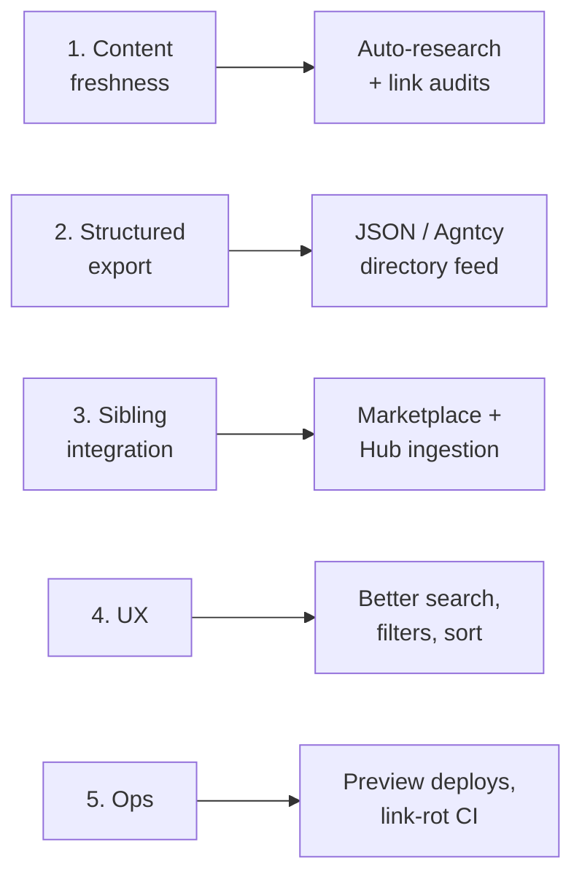
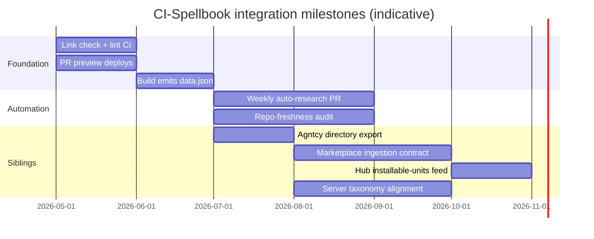

# CI-Spellbook — Roadmap

> Living plan for CI-Spellbook. Pairs with [architecture.md](architecture.md). Reviewed when issues open/close or when sibling repos (Portal, Server, Marketplace, Hub) need a new contract.

## Current state (snapshot 2026-05-18)

| Signal | Value |
| --- | --- |
| Open issues | 0 — see [issues](https://github.com/companionintelligence/CI-Spellbook/issues) |
| Last closed issue | [#2 — Add agntcy to docs](https://github.com/companionintelligence/CI-Spellbook/issues/2) (merged via PR #3) |
| Recent merges | `agntcy` knowledge-store references; Spatial Computing guide; DebugPanel refactor |
| Deploy target | Cloudflare Pages, automated on `main` |
| Content scale | 13 curated category lists |

So the active backlog is *not* in GitHub — it lives in this doc.

## Themes



## Now / Next / Later

### Now (next 1–2 weeks)

| Item | Why | Acceptance |
| --- | --- | --- |
| Add link-checker job to CI | Detect dead repo links before users do | New GitHub Action runs `lychee` or similar over `public/markdown/**`; fails PR on broken links |
| Move legacy snapshot out of `public/` | `public/markdown-legacy-20260315/` currently ships in the bundle | Snapshot lives in `archive/` (or a separate branch), not built into `dist/` |
| Cloudflare Pages preview deploys for PRs | Reviewers see content changes before merge | `wrangler pages deploy` runs on PRs with `--branch=<pr-branch>` |
| Add `data.json` build step | Foundation for sibling integration | `npm run build` emits `dist/data.json` derived from `public/markdown/*.md` |

### Next (1–2 months)

| Item | Why | Acceptance |
| --- | --- | --- |
| Move card registry to data, not code | Adding a category shouldn't require editing [App.jsx](../src/App.jsx) | `cards.json` (or YAML) drives `CARD_CONFIGS`; CI validates schema |
| Markdown lint + table-shape check | The downstream `data.json` only works if every file follows the conventions | CI fails on missing `## Subcategory` headings or wrong column count |
| Auto-research job (weekly) | Tools go stale; new ones launch every week | Scheduled Action queries GitHub API + an LLM to propose `.md` additions/edits as a PR |
| Agntcy-compatible export | Closes the loop with [agntcy/dir-spec](https://github.com/agntcy/dir-spec) — already referenced in the agents list | `dist/agntcy/` directory matching the directory spec; published with the site |
| Filter & sort UI | 13 lists × N tools is hard to scan | Filter by platform (Self-hosted, Cross-platform, etc.) + sort by recency |

### Later (this quarter+)

| Item | Why | Acceptance |
| --- | --- | --- |
| Marketplace ingestion contract | Promote vetted entries into [CI-Marketplace](https://github.com/companionintelligence/CI-Marketplace) | Documented JSON contract; a Marketplace job pulls from Spellbook's published `data.json` |
| Hub installable-units feed | [CI-Hub](https://github.com/companionintelligence/CI-Hub) can offer one-click install of Spellbook picks | Subset of entries tagged `installable: true`; Hub reads the feed |
| Server integration | [CI-Server](https://github.com/companionintelligence/CI-Server) uses Spellbook taxonomy for tool metadata | Shared category vocabulary; reference link in Server docs |
| Community contribution flow | Currently all curation is internal | Issue/PR templates + a `CONTRIBUTING.md` describing the table convention |
| RSS / Atom feed of changes | Lets users (and CI-Marketing) follow updates | `dist/feed.xml` generated at build time from git log of `public/markdown/**` |

## Automation backbone

This is the answer to *"is there a way to update this content in an automated way? New research done automatically? Auto publish to cloudflare?"*

**Auto-publish to Cloudflare: already done.** [.github/workflows/ci.yml](../.github/workflows/ci.yml) deploys `dist/` to Cloudflare Pages on every `main` push (after Playwright passes), via the official `cloudflare/wrangler-action@v3`. No further work needed there — extending it means adding *previews* and *scheduled* jobs alongside.

### Pipeline we want

```mermaid
flowchart TB
    subgraph Sched["Scheduled (weekly cron)"]
        S1[research.yml<br/>GitHub Action]
        S1 --> S2[Query GitHub Search API<br/>for new tools per category]
        S2 --> S3[Query existing repos<br/>stars / last commit / archived?]
        S3 --> S4[LLM proposes diff<br/>to public/markdown/*.md]
        S4 --> S5[Open PR<br/>with diff + sources]
    end

    subgraph PR["On PR"]
        P1[ci.yml — test job]
        P2[link-check.yml<br/>lychee over markdown]
        P3[markdown-lint.yml<br/>schema check]
        P4[Pages preview deploy]
        P5[Human review]
    end

    subgraph Main["On push to main"]
        M1[ci.yml — test]
        M2[Build dist/ + data.json + agntcy/]
        M3[Cloudflare Pages deploy]
        M4[Notify CI-Marketing<br/>(optional)]
    end

    S5 --> P5
    P1 --> P5
    P2 --> P5
    P3 --> P5
    P4 --> P5
    P5 -->|merge| M1
    M1 --> M2 --> M3 --> M4
```

### Concrete pieces

| Piece | Mechanism | Trigger | Output |
| --- | --- | --- | --- |
| **Auto-publish to Cloudflare** ✅ already | `cloudflare/wrangler-action@v3` in [ci.yml](../.github/workflows/ci.yml) | Push to `main` | Production deploy |
| **PR preview deploys** | Same action with `--branch=<pr-branch>` | PR | Per-PR URL |
| **Link rot detection** | [`lycheeverse/lychee-action`](https://github.com/lycheeverse/lychee-action) | Weekly cron + PR | Issue or PR comment with dead links |
| **Repo freshness audit** | Custom job: `gh api` over every link in `public/markdown/**` | Monthly cron | PR annotating archived / unmaintained repos |
| **Auto-research** | GitHub Action calling Claude/OpenAI with: <br/>· current `.md` content <br/>· GitHub trending / search results for the category <br/>· "propose additions/edits as a unified diff" | Weekly cron | Auto-PR with diff and citations |
| **Structured export** | Build step parses `public/markdown/**` → `dist/data.json` + `dist/agntcy/` | Every build | Stable feed for siblings |
| **Schema validation** | `markdownlint` + custom AST check on table columns | PR | Hard fail on shape drift |
| **Cross-repo notify** | Webhook / `repository_dispatch` to [CI-Marketplace](https://github.com/companionintelligence/CI-Marketplace) and [CI-Marketing](https://github.com/companionintelligence/CI-Marketing) | On successful main deploy | Marketplace re-pulls; Marketing drafts social posts |

### Why an *auto-PR* loop, not direct commits

Curation quality is the moat. The auto-research job should never write to `main` — it opens a PR a human reviews. That keeps the recommendation list trustworthy and gives the LLM a tight feedback loop (PR comments become next week's prompt context).

### Suggested first cut of `research.yml`

| Step | Tool | Notes |
| --- | --- | --- |
| Checkout | `actions/checkout@v4` | — |
| Setup Node | `actions/setup-node@v4` | For the script |
| Discover candidates | `gh api search/repositories` per category | Stars > N, pushed_at < 6mo, license OK |
| Diff current vs. candidates | Node script | Identify net-new tools |
| Call LLM | `anthropic` or `openai` SDK | Prompt: current markdown + candidates → propose patch |
| Open PR | `peter-evans/create-pull-request` | Title: `research: weekly tool refresh <date>` |
| Required secrets | `ANTHROPIC_API_KEY` / `OPENAI_API_KEY` | Plus existing `GITHUB_TOKEN` |

## Cross-repo integration roadmap



## Risks & open questions

| Risk | Mitigation |
| --- | --- |
| LLM-proposed additions degrade curation quality | Auto-PR + human merge gate; require citations in PR body |
| Cloudflare deploy uses secrets in PR previews (token exposure) | Use a Pages project with preview deploys scoped to the repo; review token permissions |
| `public/markdown/` shape drift breaks `data.json` consumers | Schema-validate in CI; version `data.json` (`/v1/data.json`) |
| Markdown-legacy snapshot bloats the bundle | Move out of `public/` (in **Now**) |
| Search scales poorly past ~100 entries | Move to prebuilt index served as a static asset |

## How to keep this doc fresh

| Trigger | Action |
| --- | --- |
| Open/close an issue tagged `roadmap` | Update Now/Next/Later tables |
| Sibling repo opens a contract issue here | Add row to "Cross-repo integration" |
| Weekly auto-research PR merges | Update "Current state" snapshot date |
| Cloudflare or Actions config changes | Update "Automation backbone" + [architecture.md](architecture.md) |
